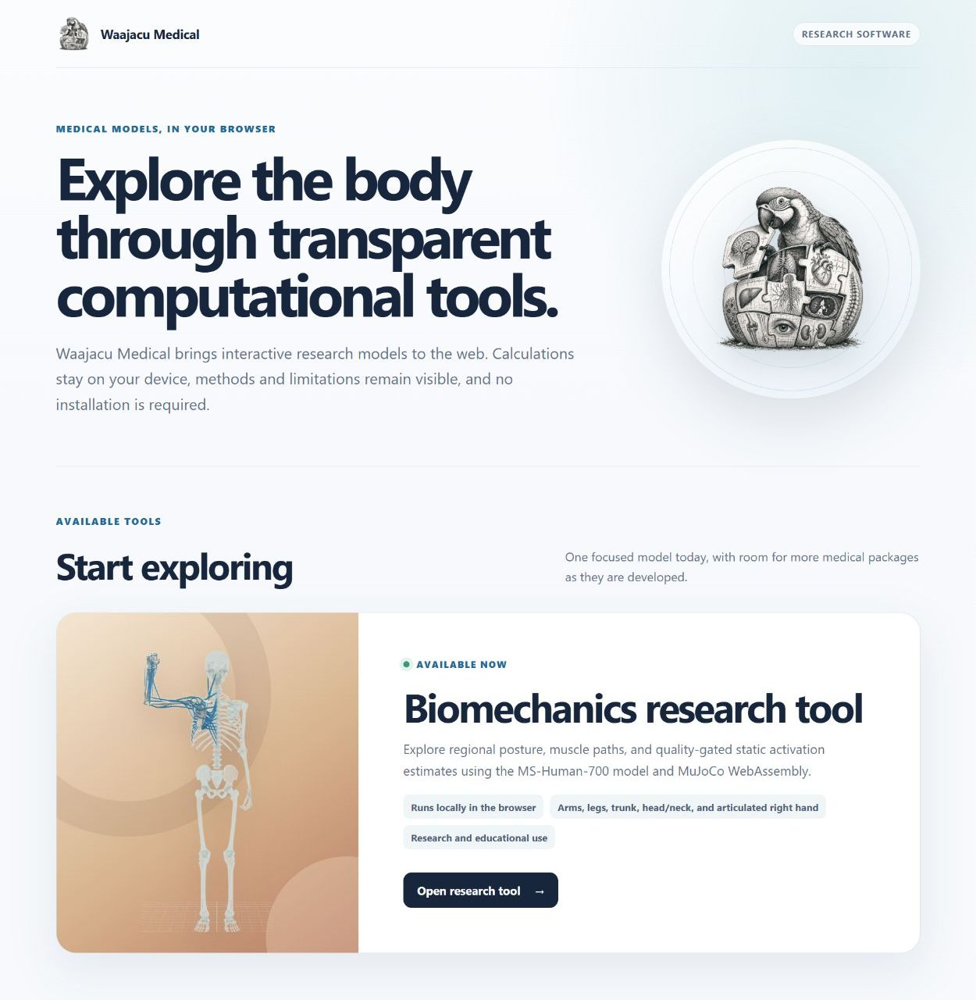
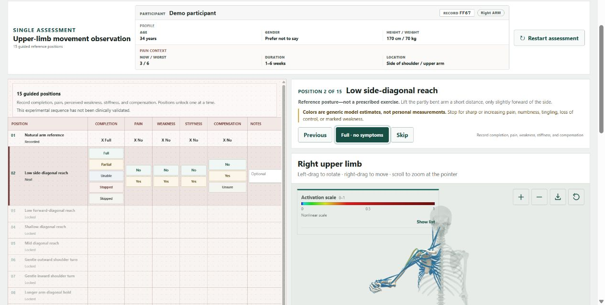

# Waajacu Medical

Waajacu Medical is a collection of browser-based research and educational
tools. The repository is organized as a monorepo so each tool can keep its own
source, verification, and licensing boundary while sharing one public catalog.

## Screenshots

### Medical catalog

<a href="https://medical.waajacu.com/">
  
</a>

### Guided assessment

<a href="https://medical.waajacu.com/en/tools/muscles/">
  
</a>

## Published routes

- `/` - catalog of available medical tools
- `/en/tools/muscles/` - Biomechanics research tool, English interface
- `/es/tools/muscles/` - Spanish interface
- `/de/tools/muscles/` - German interface
- `/el/tools/muscles/` - Greek interface
- `/cs/tools/muscles/` - Czech interface
- `/zh/tools/muscles/` - Simplified Chinese interface
- `/muscles/` - compatibility redirect to the canonical tool route

The public site is assembled by `.github/workflows/pages.yml`. Only `site/`,
the catalog logo, and each explicitly selected tool's static distribution are
included in the GitHub Pages artifact. Development files and `tmp/` are never
published.

## Tools

### Biomechanics research tool

The source is in `muscles/` and its browser distribution is
`muscles/public/`. Docker Desktop is the preferred local runtime:

```powershell
powershell.exe -NoProfile -ExecutionPolicy Bypass -File .\muscles\run.ps1
```

This creates or reuses the loopback-only `ms-human-muscles` container and
serves the application at <http://127.0.0.1:8080>. See the
[muscles README](./muscles/README.md) for container lifecycle and custom-port
instructions. The container is only a static web host; the model and solver
still run in the browser.

The independent verification command is:

```powershell
powershell.exe -NoProfile -ExecutionPolicy Bypass -File .\muscles\release.ps1
```

The application runs locally in the browser. It is research and educational
software, not a medical device.
